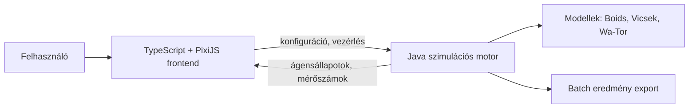

# Multi-agent szimuláció emergens viselkedés vizsgálatához
## 1. Szereplők és jogosultságok

| Szerep | Igény | Felelősség / hozzáférés |
| --- | --- | --- |
| Felhasználó (kísérletező) | Szimulációk futtatása, paraméterezése és az emergens viselkedés megfigyelése | Modellt választ, paramétereket állít, futtatást indít, megtekinti a megjelenítést és a mérőszámokat. |
| Modellfejlesztő (hallgató) | Új vagy módosított ágensszabályok kipróbálása | Szabályokat és modelleket valósít meg a szimulációs motorban, teszteket ír hozzájuk. |

## 2. Use case-ek

### Szimuláció futtatása valós időben

- **Szereplő:** Felhasználó
- **Előfeltétel:** A backend fut, és legalább egy modell (Boids, Vicsek, Wa-Tor) elérhető.
- **Fő folyamat:**
  - A szereplő kiválaszt egy modellt.
  - A rendszer megjeleníti a modell paramétereit alapértelmezett értékekkel.
  - A szereplő beállítja a paramétereket pl. ágensszám, sebesség, látótávolság, szabálysúlyok és opcionálisan egy seed-et.
  - A szereplő elindítja a szimulációt valós idejű módban.
  - A rendszer lépésenként frissíti az ágensek állapotát, a frontend pedig folyamatosan kirajzolja azokat.
  - A rendszer közben számolja és megjeleníti az emergens viselkedést jellemző mérőszámokat.
  - A szereplő szüneteltetheti, folytathatja vagy leállíthatja a szimulációt.
- **Alternatív / hibafolyamatok:** Érvénytelen paraméterérték esetén a rendszer hibaüzenetet ad, és nem indítja el a szimulációt.
- **Utófeltétel:** A futtatás paraméterei és mérőszámai az aktuális munkamenetben elérhetők.

### Szimuláció futtatása batch módban

- **Szereplő:** Felhasználó
- **Előfeltétel:** A felhasználó kiválasztott egy modellt és megadott paramétereket.
- **Fő folyamat:**
  - A szereplő batch azaz nem valós idejű futtatást választ, és megadja a lépések számát.
  - A rendszer a megjelenítéstől függetlenül, a lehető leggyorsabban lefuttatja a szimulációt.
  - A rendszer lépésenként rögzíti a mérőszámokat.
  - A futás végén a rendszer megjeleníti az eredményeket (idősor, összegző értékek), és exportálhatóvá teszi azokat.
- **Alternatív / hibafolyamatok:** Ha a futás megszakad vagy hibára fut, a rendszer jelzi a hibát, és nem ad ki részleges eredményt teljesként.
- **Utófeltétel:** Azonos modell, paraméterek és seed mellett a futás megismételhető, és ugyanazt az eredményt adja.

### Modellek összehasonlítása

- **Szereplő:** Felhasználó
- **Előfeltétel:** Legalább két modell vagy paraméterkészlet lefutott.
- **Fő folyamat:**
  - A szereplő kiválaszt két vagy több lefutott szimulációt.
  - A rendszer egymás mellett megjeleníti a mérőszámaikat.
  - A szereplő megfigyeli, hogyan változik az emergens viselkedés a paraméterek vagy a modell függvényében.
- **Alternatív / hibafolyamatok:** Nem összevethető mérőszámok esetén a rendszer csak a közös mérőszámokat mutatja.
- **Utófeltétel:** Az összehasonlítás alapján dokumentálható a modellek közötti eltérés.

## 3. Funkcionális követelmények

| Követelmény | Elfogadási kritérium | Prioritás |
| --- | --- | --- |
| A felhasználó kiválaszthat egy szimulációs modellt. | Adott elérhető modellnél, amikor a felhasználó kiválasztja azt, a rendszer megjeleníti a modell paramétereit alapértékekkel. | Kötelező |
| A rendszer Boids modellt valósít meg szeparáció, igazodás és kohézió szabályokkal. | Adott paraméterezett Boids szimulációnál a rajmozgás megfigyelhető, és a szabályok súlya állítható. | Kötelező |
| A rendszer ragadozó-préda (Wa-Tor) modellt valósít meg. | Adott kezdeti populációnál a ragadozók és prédák száma a modell szabályai szerint alakul. | Kötelező |
| A felhasználó paraméterezheti a szimulációt futtatás előtt. | Adott paraméterkészletnél, amikor a felhasználó elindítja a futást, a szimuláció ezekkel az értékekkel indul. | Kötelező |
| A felhasználó valós idejű és batch futtatási mód között választhat. | Adott kiválasztott módnál a rendszer a módnak megfelelően fut: valós időben megjelenít, batch módban csak számol és rögzít. | Kötelező |
| A rendszer valós időben kirajzolja az ágenseket. | Adott futó szimulációnál az ágensek helyzete és iránya folyamatosan frissül a böngészőben. | Kötelező |
| A rendszer mérőszámokat számol az emergens viselkedésről. | Adott futásnál a rendszer lépésenként számolja pl. a rendparaméter, a csoportok száma és az átlagos szomszédtávolság értékét, valamint a populációméreteket a Wa-Tor modellnél. | Kötelező |
| A felhasználó szüneteltetheti, folytathatja és újraindíthatja a szimulációt. | Adott futó szimulációnál, amikor a felhasználó szünetet kér, az állapot nem változik a folytatásig. | Kötelező |
| A szimuláció seed megadásával determinisztikusan megismételhető. | Adott modell, paraméterek és seed mellett két futás azonos állapotsorozatot ad. | Kötelező |
| A felhasználó exportálhatja a batch futás mérőszámait. | Adott lefutott batch szimulációnál az eredmények fájlként (pl. CSV) letölthetők. | Ajánlott |
| A felhasználó összehasonlíthat több futást. | Adott két lefutott szimulációnál a mérőszámok egymás mellett megjeleníthetők. | Ajánlott |
| A rendszer paraméterkészleteket menthet és tölthet be. | Adott mentett paraméterkészletnél a betöltés után a paraméterek megegyeznek a mentettel. | Lehetséges |

Prioritás: **Kötelező** = a végtermékhez szükséges; **Ajánlott** = fontos; **Lehetséges** = idő esetén opcionális.

## 4. Üzleti szabályok és korlátok

| Szabály vagy korlát | Indoklás |
| --- | --- |
| A szimulációs logika szigorúan elkülönül a megjelenítéstől. | A feladat követelménye; lehetővé teszi a batch futtatást és a logika önálló tesztelését. |
| Az ágensek csak egyszerű, helyi szabályok alapján működnek, globális vezérlés nélkül. | Az emergens viselkedés lényege, hogy a globális mintázat a helyi szabályokból alakul ki. |
| Azonos modell, paraméterek és seed mellett a szimuláció eredménye azonos. | A mérések és az összehasonlítás csak így megismételhetők. |
| A paramétereket a rendszer a megengedett tartományon belül fogadja el. | Megakadályozza az értelmetlen vagy a rendszert túlterhelő futtatásokat. |
| A fontosabb szimulációs szabályokhoz automatizált tesztek tartoznak. | A feladat követelménye; védi a szabályok helyességét változtatás közben. |
| A rendszer helyi (localhost) környezetben futtatható. | A feladat nem követeli meg a külső üzemeltetést. |

## 5. Felhasználói felület és munkafolyamat

A felület egy fő nézetből áll. Oldalt található a vezérlőpanel: modellválasztó, paraméterek, futtatási mód (valós idejű / batch), valamint indítás, szünet és újraindítás gomb. A fő területen a PixiJS-szel kirajzolt szimulációs tér látható, mellette a mérőszámok élő grafikonjai. Batch módban a rendszer a futás végén eredménynézetet ad az idősorokkal és az exportálási lehetőséggel. A felhasználó a paraméterek módosítása után új futást indíthat, és összehasonlíthatja a korábbiakkal.

## 6. Nem funkcionális követelmények

| Követelmény | Ellenőrzés módja |
| --- | --- |
| Valós idejű módban a rendszer legalább 2000 ágenst képes 30 FPS körüli megjelenítéssel kezelni. | Teljesítménymérés különböző ágensszámokkal, a tényleges érték kísérleti finomításával. |
| Batch módban a szimuláció a megjelenítés nélkül lényegesen gyorsabban fut, mint valós időben. | Összehasonlító időmérés azonos futásokkal valós idejű és batch módban. |
| Azonos seed mellett a futások eredménye megegyezik. | Automatizált teszt két azonos futás állapotának összehasonlításával. |
| A fontosabb szabályok (mozgás, szomszédkeresés, populációváltozás) automatizált tesztekkel lefedettek. | Tesztfuttatás és a tesztek áttekintése a repóban. |
| Egy új felhasználó külső dokumentáció nélkül el tud indítani egy szimulációt. | Megfigyeléses használhatósági teszt egy reprezentatív felhasználóval. |

## 7. Nyitott kérdések és kockázatok

| Kérdés / kockázat | Hatás | Felelős | Feloldás / döntés |
| --- | --- | --- | --- |
| Mely mérőszámok mutatják a legjobban az emergens viselkedést az egyes modelleknél? | Befolyásolja a mérhetőséget és az összehasonlítást. | Hallgató | Szakirodalmi kutatás; kezdetben rendparaméter, csoportszám és szomszédtávolság. |
| Milyen módon kommunikáljon a frontend a backenddel valós időben? | Befolyásolja a késleltetést és az architektúrát. | Hallgató | WebSocket és REST prototipizálása; a választás a mérés alapján. |
| Nagy ágensszámnál a naiv szomszédkeresés (O(n²)) lassú lehet. | Befolyásolja a teljesítményt. | Hallgató | Térbeli indexelés (pl. rács) bevezetése, ha a mérés indokolja. |
| Mi az ágensek állapotának és a mérőszámoknak a megfelelő átviteli formátuma? | Befolyásolja a hálózati terhelést valós időben. | Hallgató | Tömör formátum (pl. csak pozíció és irány) kísérleti összevetése. |
| A Boids és a Wa-Tor modell kellően összehasonlítható-e? | Befolyásolja az összehasonlítás értelmét. | Hallgató | Közös mérőszámok kijelölése, a nem közös mutatók külön kezelése. |

## 8. Kezdeti technikai javaslat

### Javasolt megoldás

A javasolt rendszer egy Java szimulációs motorból (backend) és egy TypeScript alapú webes frontendből áll. A motor tartalmazza az ágensmodelleket és a szabályokat, a megjelenítéstől függetlenül futtatható, és a mérőszámokat is számolja. A frontend PixiJS-szel kirajzolja az ágenseket, és vezérlőfelületet ad a paraméterezéshez. A két réteg a motor kimenetén (ágensállapotok, mérőszámok) keresztül kapcsolódik. A rendszer localhoston fut.

### Technológiai irány

| Terület | Jelölt technológia / megközelítés | Megfontolás oka | Nyitott kérdés / kockázat |
| --- | --- | --- | --- |
| Szimulációs motor | Java | Jó teljesítmény nagy ágensszámnál, erős típusosság | A korábban mérlegelt C# helyett Java a választás; a döntés indoka dokumentálandó. |
| Frontend | TypeScript | Típusos webes fejlesztés, jó illeszkedés a PixiJS-hez | A keretrendszer (vagy keretrendszer nélküli megoldás) kiválasztandó. |
| Megjelenítés | PixiJS | Hatékony 2D renderelés sok objektummal | Számomra teljesen ismeretlen technológia |
| Kommunikáció | WebSocket (valós idejű) és HTTP/REST (batch, konfiguráció) | Folyamatos állapotküldés és egyszerű vezérlés | Prototipizálással igazolandó. |
| Tesztelés | JUnit a motorhoz | Szabályok automatizált ellenőrzése | A frontend tesztelésének mértéke eldöntendő. |
| Verziókezelés | Git | A feladat követelménye | Titkos adatok kizárása (.gitignore) kötelező. |

### Kezdeti architektúravázlat

### Megvalósíthatóság és technikai kockázatok

| Kockázat / feltételezés | A 2. félévre tervezett validáció | Tartalék megközelítés |
| --- | --- | --- |
| A Java motor nagy ágensszámnál is elég gyors valós idejű módban. | Teljesítménymérés növekvő ágensszámmal, térbeli indexeléssel és anélkül. | Ágensszám korlátozása, vagy frissítési ráta csökkentése. |
| A frontend és a backend közötti állapotátvitel lehet, hogy lesz szűk keresztmetszet. | Prototípus mérésekkel különböző üzenetméretekkel. | Tömörebb formátum, ritkább küldés vagy a frontend oldali interpoláció. |
| A kettő modell közös mérőszámokkal összehasonlítható. | Kisebb kísérlet közös metrikákkal mindkettő modellen. | Modellenkénti picit eltérő mérőszámok |
